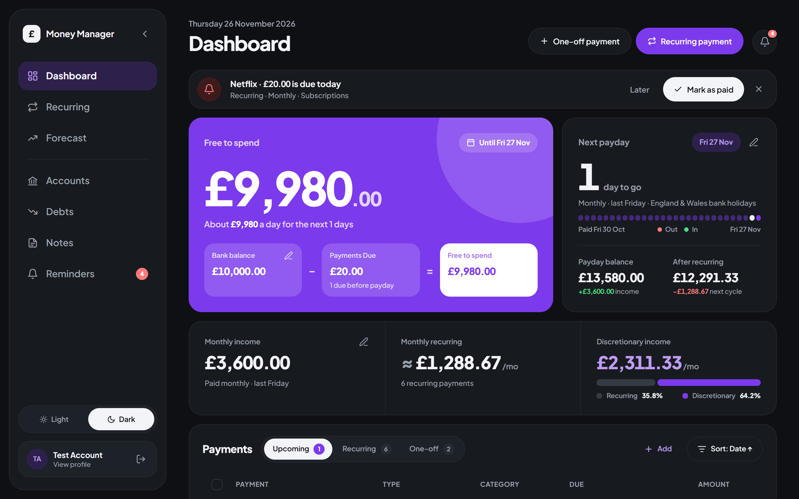
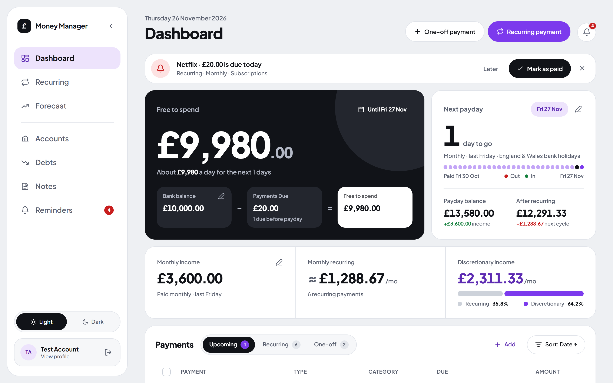
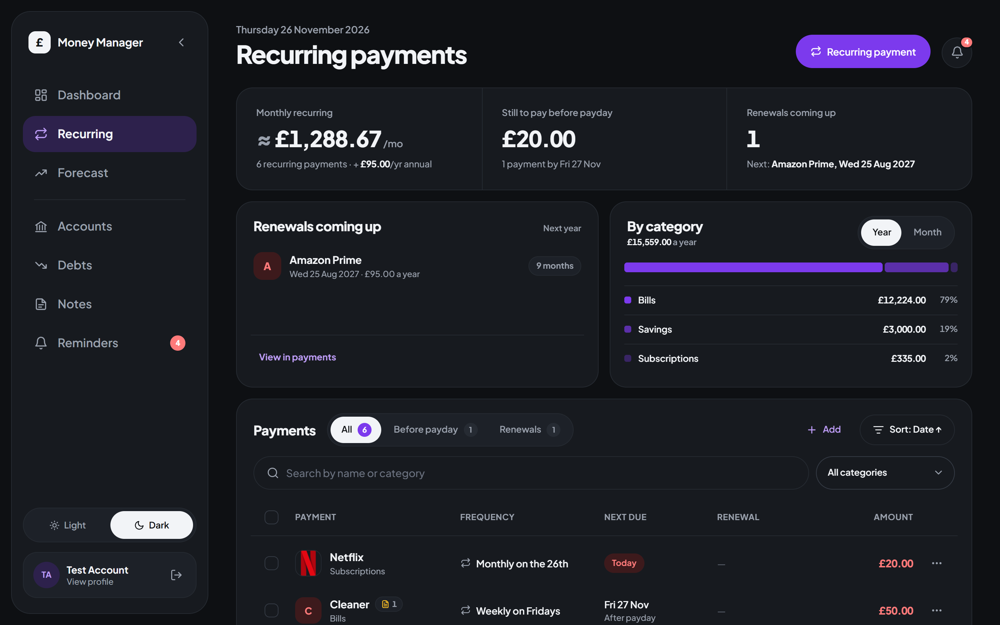
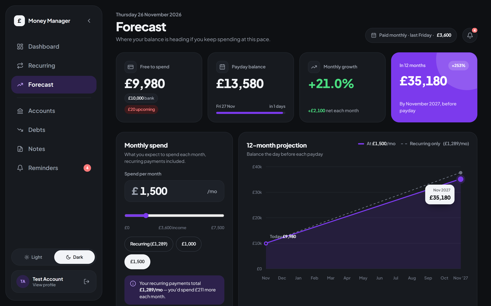
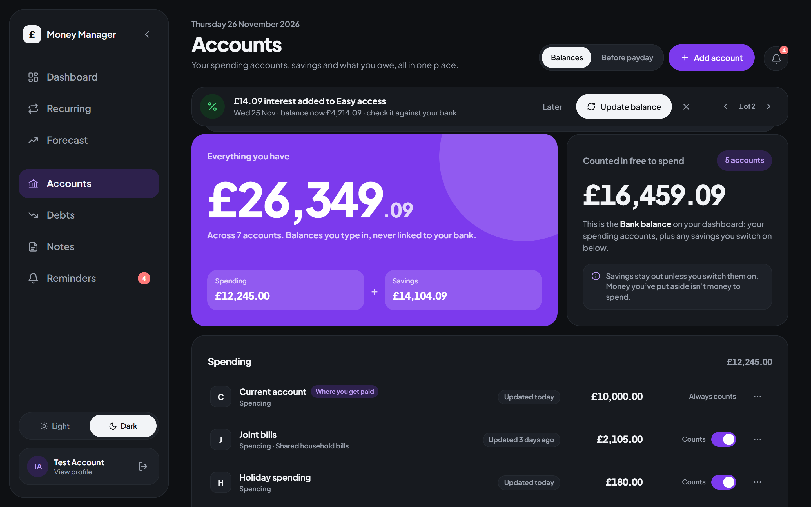
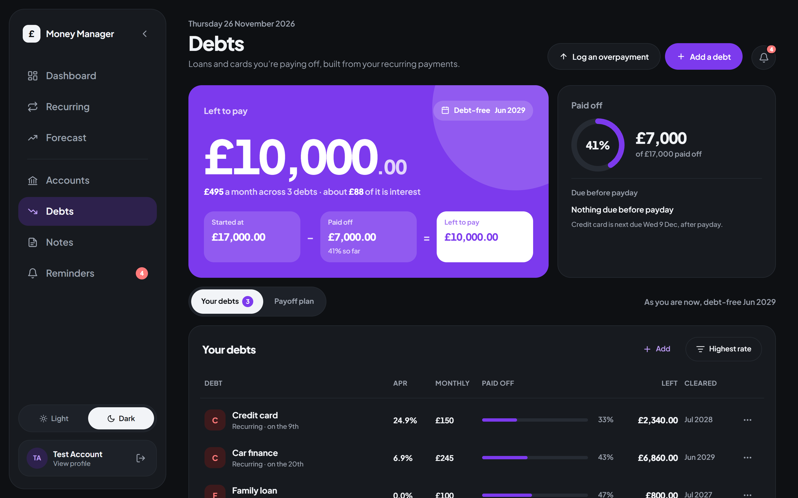
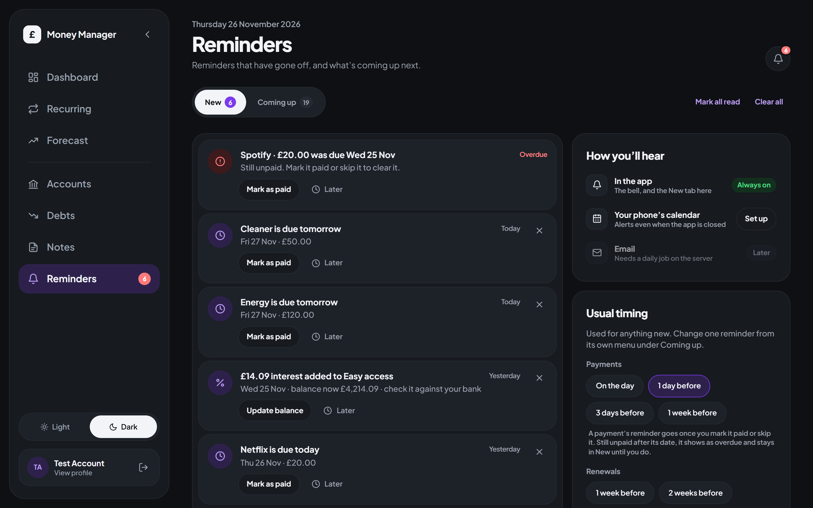
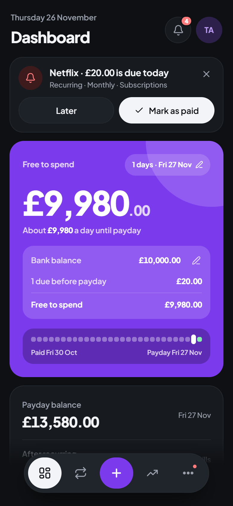
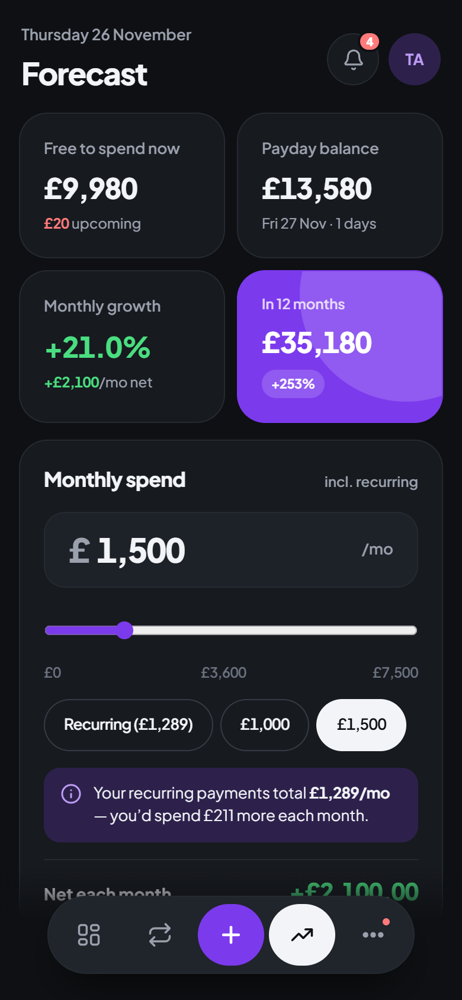
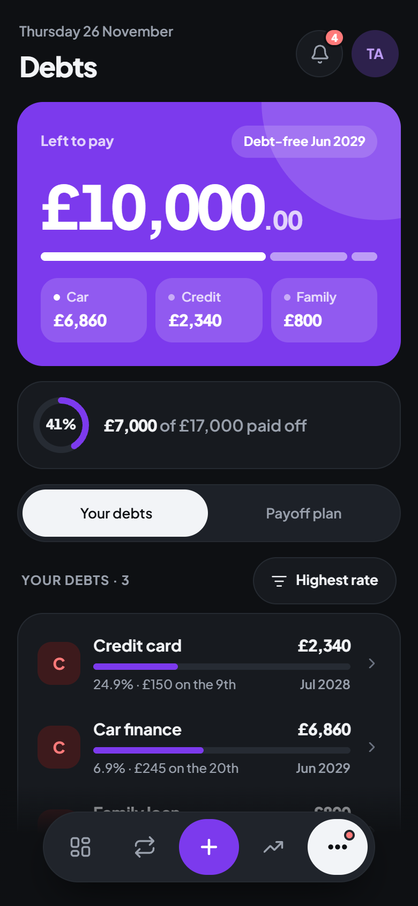

# Money-Manager

Front-end for web app built that tracks finances using React and GraphQL

## App Preview

https://craig-money-manager.netlify.app/

## Desktop Preview

### Dashboard

Light mode

### Recurring payments

### Forecast

### Accounts

### Debts

### Reminders

## Mobile Preview

  
  
  

[See Back-end API here](https://github.com/Craig-97/Money-Manager-API)
